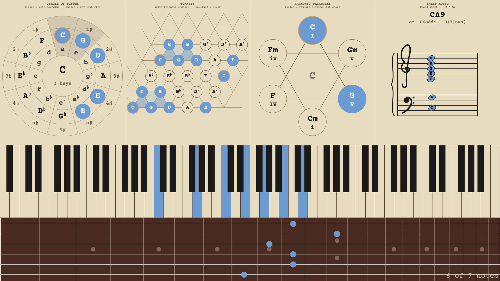

# Tangent

**Play. Tangent writes it down, explains it, and hands you the video.**

### [⬇ Download](https://github.com/ganten1998/tangent/releases/latest) &nbsp;·&nbsp; [♥ Support Tangent](https://ganten.gumroad.com/l/ivory)



Tangent is a small recording DAW built around one idea: the app should show
you what you are playing while you play it, and keep what you played.

Plug in a MIDI keyboard and play. Tangent renders all 88 keys in real time
while a weighted-scoring chord engine names what you are holding, from plain
triads to altered dominants, rootless jazz voicings, slash chords, and scales.
It **engraves it on a staff**, shows the same notes **on a guitar neck** where
a player would actually put their fingers, and **as geometry**: the circle of
fifths, a Tonnetz, and the I-IV-V triangles.

Then it records the whole thing, and keeps going from there. Tangent 5.0 is
three tools in one window:

**A teaching tool.** Everything a student needs is on screen at once and in
one another's terms: the notes under your hands, the name of what they make,
the notation for it, and the geometry that explains why it sounds like that.
Switch the staff to any of six clefs and every note is written in that clef,
so a violist or a cellist can read the chord in their own clef, off one
keyboard. Teach it a chord name it does not know and it is yours from then on.

**A recording tool.** One press writes a `.wav`, a `.mid` and a composited
`.mp4`, and the video **is the window**: the same panels in the same places,
with your camera already placed in it, at 16:9. There is no scene to build, no
overlay to align, no second layout to keep in step with the first. What you
were looking at is what your audience sees. macOS encodes natively; the
Windows and Linux downloads carry their own encoder, so filming a take needs
nothing installed. There is a native **Stream to OBS** sender too, for going
live instead of to a file.

**A DAW.** A desk with a mixer, an arrangement view, a MIDI editor and a drum
machine. The free app holds up to 32 tracks and a supporter key takes the limit
away; buses, returns, sends and routes have no limit for anyone. Folders are
real buses that count as tracks: a group sums its children in the engine and
runs its own insert rack over the sum. Automation reaches track controls and plugin parameters
alike, the tempo lane does ramps and steps, clips time-stretch from their
edges, audio takes quantize as well as MIDI, and delay compensation understands
groups. It **hosts your plugins**: VST3 on every platform, LV2 on Linux and
FreeBSD, editor windows included, and a new session opens with the built-in
Tangent DX7 armed and set to a tine electric piano, so the app makes a sound
out of the box.

It runs on macOS 11 (Big Sur) and later, on Windows 10 and later, on Linux
(x86_64 and aarch64, glibc 2.30+, ALSA, Wayland or X11), and on FreeBSD 15
(amd64).

## Download

| Platform | Installer | Or unpack it yourself |
|---|---|---|
| macOS 11+ | [`.pkg`](https://github.com/ganten1998/tangent/releases/latest/download/Tangent-macos.pkg) | [`.dmg`](https://github.com/ganten1998/tangent/releases/latest/download/Tangent-macos-universal.dmg) · [`.zip`](https://github.com/ganten1998/tangent/releases/latest/download/Tangent-macos-universal.zip) |
| Windows 10+ | [`setup.exe`](https://github.com/ganten1998/tangent/releases/latest/download/Tangent-windows-setup.exe) | |
| Linux x86_64 | `install.sh`, inside the tarball | [`.tar.gz`](https://github.com/ganten1998/tangent/releases/latest/download/tangent-linux-x86_64.tar.gz) |

macOS builds are universal (Apple Silicon and Intel), signed and notarized.
The Windows download is the installer; it puts Tangent in the Start menu and
includes an uninstaller. The Linux `install.sh` needs no root by default and
takes `--system`, `--prefix`, `--uninstall` and `--dry-run`. Other builds,
including the Windows portable zip, the Linux aarch64 tarball, the FreeBSD
package and its two offline bundles, and checksums, are on the
[releases page](https://github.com/ganten1998/tangent/releases/latest).

## Features

- **The recorder.** One press writes audio, MIDI and video together. The video
  is the window itself, with the camera composited in; the take's manifest
  records what was captured, and a take that loses its video still keeps its
  audio and its MIDI. Software monitoring, a metronome, and input trims live
  on the recorder band.
- **The mixer.** A strip for every track plus a master, each with a fader,
  pan, a send into the effects bus, an insert rack, and meters. The free desk
  holds 32 tracks; with a supporter key there is no track limit. Routing goes
  two ways: a **hardware output** sends a copy of a channel out of your
  interface's own jacks (a headphone amp, a stage monitor), and a **channel
  route** moves a channel through another channel, which is how you build a
  submix. Folders are buses that count as tracks: a group sums its children
  and runs its own rack over the sum, so a compressor in a folder's bay is a
  bus compressor.
- **The arrangement.** Audio and MIDI clips on a timeline, groups that drag
  their children with them, automation lanes for track controls and plugin
  parameters (nodes that box-select, copy, paste and make steps), a tempo
  lane with ramps and steps, time-stretch from a clip's edge (MIDI re-times,
  audio renders), **quantize** for audio takes as well as MIDI (`Q`: a
  take's attacks are found and warped onto the grid, with the attack itself
  left as it was played), and glue for audio and MIDI clips alike.
- **The MIDI editor and the drum machine.** A piano-roll editor for MIDI
  clips, and a pad-based drum machine with its own kits. The kit is the one
  thing that still saves itself, because a kit is hours of sample assignment
  and the one thing a session must never lose to a missed save. Answering
  Don't Save on a session you never saved keeps a kit built in it, in that
  session's folder. A kit can
  also be saved out as a single file that carries the samples inside it
  alongside the layout, so kits can be shared with people who do not have
  your sample folders.
- **Plugin hosting.** VST3 on macOS, Windows, Linux and FreeBSD; LV2 on Linux
  and FreeBSD; plugin editor windows everywhere. Scanning is recursive, takes
  folders you add yourself, and rescans without a restart. A new session's
  second track holds the built-in Tangent DX7, on a tine electric piano patch.
- **Stream to OBS.** A native ReaStream-compatible sender pushes the master
  over localhost UDP to the ReaStream plugin in OBS, so a lesson or a
  performance can go live without an extra audio driver.
- **Send to Device.** The master can also play out of a second output, such
  as a virtual cable (VB-Audio CABLE Input, BlackHole, Loopback), for OBS or
  Discord to record as an input. On Windows it opens the cable through
  WASAPI even while the interface plays through ASIO, and it keeps the two
  devices' clocks in step on its own.
- **Chord detection, 95 chord patterns against all 12 roots.** Triads,
  sevenths, extensions, altered dominants, add and sus chords, 6 and 6/9,
  inversions, slash chords, and rootless voicings, plus **28 scales and
  modes** when you run instead of hold. Readable labels in parenthetical
  notation (`C7(b9,#11)`, `Cm(add9)/G`) with lead sheet symbols and a
  flats/sharps preference.
- **A theory band.** Circle of fifths, Tonnetz, harmonic triangles and a
  sheet music panel, in any combination, side by side; the number keys
  `1`-`4` choose what is up and where. The sheet music panel does six clefs,
  one at a time or as the grand staff, and all fifteen key signatures. The
  band shows what you **put there** rather than what you are playing, so it
  holds still while your hands are busy; *Follow MIDI* makes it live if you
  would rather.
- **Guitar view, both ways.** A neck under the piano that places what you hold
  where a guitarist would play it, weighing hand span, open strings and
  barres, then holds the shape steady as you add notes. Seven tunings, a
  capo, three fingerboard woods. With Keytoggle on it is an input too: click
  the neck to build a shape and read the chord off the piano.
- **Teach Tangent your names.** *Teach Chord Name…* pins your name to the
  voicing you are holding, in every key if you want. *Correct Chord Name…*
  teaches a general leaning instead, so similar voicings shift too. *Manage
  Taught Chords…* lists, deletes, and can forget everything learned.
- **Thirty-two themes.** `T` cycles them; every theme carries its own palette,
  solved against contrast floors rather than picked by eye. Key and note
  colors are customizable on top.
- **Keyboard shortcuts.** Hold **H** and every view's bindings appear. **N**
  names the chord you are holding; the rest is on the card.
- **A MIDI device picker** that auto-connects at startup, and CLI flags for
  scripted setups: `tangent -l` lists MIDI input ports, `tangent -p "<port>"`
  connects to one.
- **Consistent typography everywhere.** Three typefaces are bundled and
  embedded, so the app looks identical on all platforms: Terminess Nerd Font
  Mono by default, and `F` cycles through it, Courier Prime and JetBrains Mono.

The right-click context menu is the primary UI surface. Every feature above
that is not on screen is reachable from it or from a key (hold **H** to see
the keys).

## Pay what you can

Tangent is free software (MIT) and free to download. The free app holds up to
32 tracks, and every feature is in it: recording, video, plugins, export, and
buses, returns, sends and routes with no limit for anyone. Nothing is
time-limited and nothing nags you.

A [supporter key](https://ganten.gumroad.com/l/ivory) takes the track limit
away, and it is a way to say the app earned a place in your practice room.
Every key already sold does the same: keys have no expiry and cover every
version. The limit only ever stops a new track. A project with more than 32
tracks opens, plays, edits and saves whole on a free install, and only adding
the next track asks for a key. Pay what you like, and if you cannot afford it,
just use the app.

## Support

Something broken, or something missing? Open an issue on the
[tracker](https://github.com/ganten1998/tangent/issues), or email
<tangentdaw@gmail.com>. Both are read by the author.

## Privacy

Tangent collects no data. There is no telemetry, no update check, and no
account. Your settings, your projects and your taught chords stay on your
machine, in `~/.config/tangent/` and wherever you save your work. Supporter
keys are verified offline with a signature check, so no server is contacted
then either. The one network feature is the OBS stream, which is off by
default and, when you turn it on, sends audio to an address you choose (your
own machine, unless you say otherwise). Tangent itself opens no other network
connection. A plugin you load runs inside Tangent but is its maker's program,
so what it connects to is up to its maker.

## A note on the name

Tangent was called **Ivory** until 2.3.0. For a while the rename was surface
deep, and this file used to claim the internals would never follow, so that
nobody's settings would be orphaned. That stopped being true in 5.0, which
finished the job deliberately: the crates are `tangent-*`, the macOS bundle
identifier is Tangent's own, and configuration moved to `~/.config/tangent/`.
5.0 treats the old `~/.config/ivory/` directory as a clean break rather than
migrating it, and removes it at first launch; 5.0 was also the point where
projects, desks and themes made the old files historical. What survives of
"ivory" in the source (some type names, the `IVORY_*` developer switches) is
internal and on its way out.

The clavichord's tangent is the brass blade at the back of each key. It
strikes the string and stays in contact with it for as long as the note
sounds, which is what the display does with a held note.

Downloads published under the old `Ivory-*` asset names keep working; every
release uploads those alongside the current ones.

## Licensing

Tangent and every crate in this repo are **MIT**. The Windows and Linux
artifacts bundle a GPL build of ffmpeg as a separate program
(`tangent-ffmpeg`; on Linux we build it ourselves, on Windows it is BtbN's),
which is an aggregate, not a combined work; its licenses
and provenance ship beside it in `ffmpeg-licenses/`. The source for those
builds is published as releases of this repository:
[`third-party-src-ffmpeg-n8.1.3-btbn-2026-09-22`](https://github.com/ganten1998/tangent/releases/tag/third-party-src-ffmpeg-n8.1.3-btbn-2026-09-22)
for Windows and
[`third-party-src-ffmpeg-8.1.3-tangent-linux`](https://github.com/ganten1998/tangent/releases/tag/third-party-src-ffmpeg-8.1.3-tangent-linux)
for Linux. The macOS and FreeBSD builds link LAME (LGPL) for MP3 export; its
licence texts ship beside the app in `lame-licenses/`. `LICENSING.md` records
the reasoning.

## Building from source

Requires a stable Rust toolchain (rustup recommended).

```sh
cargo run --bin tangent         # debug build, run directly
cargo build --release --bin tangent
cargo test --workspace          # engine + UI + parity test suite
```

Release packaging lives in `scripts/`: `build-macos.sh` for the signed and
notarized macOS bundle, and `build-cross.sh`, which cross-builds the Windows
installer and both Linux tarballs from a macOS host. `build-linux-native.sh`
builds natively on a Linux machine, and `build-freebsd.sh` on FreeBSD. See
`docs/RELEASE.md` for the full procedure.

## Platform notes

- **macOS.** Release builds are signed with a Developer ID certificate and
  notarized by Apple, with the ticket stapled to the bundle, so the app opens
  on a double-click with no Gatekeeper prompt and no need to be online.
- **Windows.** Every program in the Windows download (the installer, the
  app, its video encoder and the uninstaller) is signed under the author's
  name, and a release cannot be cut with any of them unsigned, so Windows
  11's Smart App Control, which runs a program it does not know only if it
  is signed, lets Tangent run. SmartScreen goes on reputation, which a new
  signature has to earn, so it may still show "Windows protected your PC"
  on first run: click **More info**, then **Run anyway**.
- **Linux.** The tarball's `install.sh` installs to your home directory with
  no root. Two system libraries need to be present. MIDI and audio go through
  ALSA, so `libasound.so.2` is required (`libasound2` on Debian and Ubuntu,
  `alsa-lib` elsewhere); it is on essentially every desktop already. LV2
  hosting needs `liblilv-0.so.0`, which arrives with PipeWire or ffmpeg on
  nearly every distribution; the one common desktop without it is stock
  Ubuntu GNOME, where it is `sudo apt install liblilv-0-0`. `install.sh`
  checks both and prints your distribution's command. Filming a take wants a
  Vulkan driver (mesa's lavapipe works on any GPU). PipeWire systems work
  unchanged, and JACK is selectable in Audio Setup for pro-audio sessions.
  Wayland and X11 are both supported, though some tiling compositors treat
  Tangent's window sizes as advisory.

## Fonts and licensing

Tangent's executable embeds ten font files, all free and libre. Every release
artifact carries the full license text for each one.

**Courier Prime** (Regular and Bold) is one of the three UI typefaces,
Copyright 2015 The Courier Prime Project Authors, licensed under the
[SIL Open Font License 1.1](https://openfontlicense.org). Its license text
(`OFL.txt`) ships alongside the fonts. Tangent does **not** bundle or
redistribute Courier New.

**Terminess Nerd Font Mono** (Copyright 2020 Dimitar Toshkov Zhekov, 2023
Tilman Blumenbach) and **JetBrains Mono** (Copyright 2020 The JetBrains Mono
Project Authors) are the other two, both under the SIL Open Font License 1.1,
with their license texts in `font-licenses/`. Terminess is the one a fresh
install uses, and the `F` key steps through all three: Courier Prime,
Terminess, JetBrains Mono.

Four more fonts come in automatically with eframe/egui's `default_fonts`
feature (the `epaint_default_fonts` crate) and serve as glyph fallback for
anything the bundled typefaces do not cover. The context menu's submenu arrow
(⏵), for instance, exists only in `emoji-icon-font`. Their license texts ship
in the `font-licenses/` folder of every artifact:

| Font | Copyright | License | Text |
|---|---|---|---|
| Ubuntu Light | 2011 Canonical Ltd. | Ubuntu Font Licence 1.0 | `font-licenses/Ubuntu-Font-Licence-1.0.txt` |
| Noto Emoji | 2013 Google Inc. | SIL OFL 1.1 | `font-licenses/NotoEmoji-OFL-1.1.txt` |
| Hack | 2018 Source Foundry Authors; 2003 Bitstream, Inc. | MIT + Bitstream Vera | `font-licenses/Hack-LICENSE.txt` |
| emoji-icon-font | 2014 John Slegers | MIT | `font-licenses/emoji-icon-font-MIT.txt` |

No font is modified, subset, or sold standalone. Tangent's own MIT grant
([LICENSE](LICENSE)) covers Tangent's code only. The embedded fonts remain
under the licenses above. A `custom_font_path` setting lets you point Tangent
at any TTF or OTF installed on your own machine instead.

## Changes

Release history, including the original Python lineage, is in
[CHANGELOG.md](CHANGELOG.md).

## Thanks

- **Omer**, for the rounded macOS app icon of the 2.x era; the current icon is
  the app's own Tonnetz wordmark.
- **Hatsu**, for extensive Windows testing and feedback, on a platform the
  author does not develop on and could not have got right alone.
- **Joanne**, for knowing what the sheet music panel had to be before it
  existed. The staff view is in Tangent because of them, and it reads the way
  it does because of what they said about the first attempt.

## License

MIT, see [LICENSE](LICENSE). Copyright (c) 2025-2026 Ganten.
Licenses of the Rust crates Tangent links against are collected in
[THIRD-PARTY-LICENSES](THIRD-PARTY-LICENSES).

MIT means you may rebuild, modify and redistribute Tangent freely.
