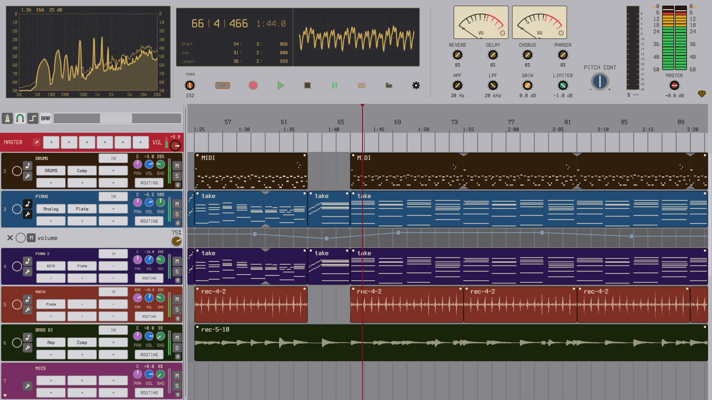
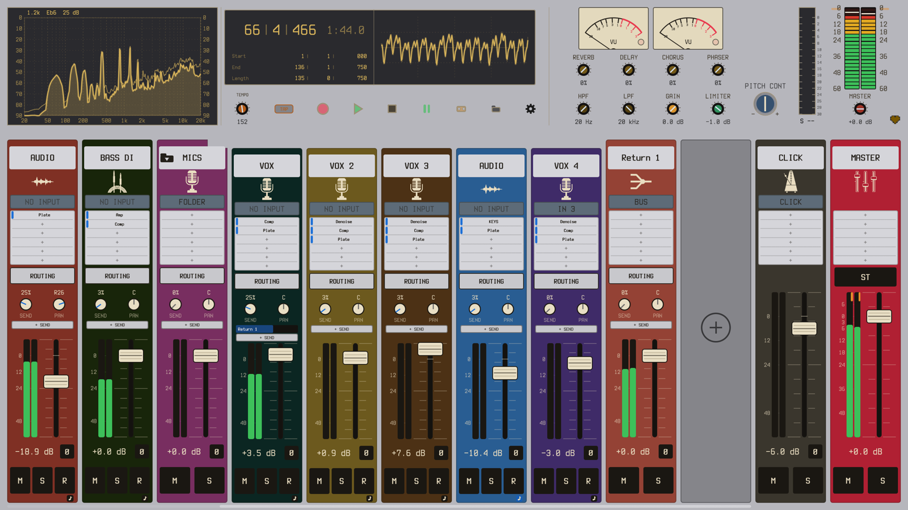

# Tangent

**Record, arrange and mix on macOS, Windows, Linux and FreeBSD.**

Free with up to 32 tracks; a supporter key removes the limit.

### [⬇ Download](https://github.com/ganten1998/tangent/releases/latest) &nbsp;·&nbsp; [♥ Support Tangent](https://ganten.gumroad.com/l/tangent)





Tangent is a digital audio workstation for macOS, Windows, Linux and
FreeBSD. You record audio and MIDI into it, arrange clips on a timeline,
edit notes in a piano roll, and mix on a desk with buses, returns, sends,
folders and automation. It hosts VST3 plugins on every platform and LV2
plugins on Linux and FreeBSD, and it ships its own instruments and effects,
so a new session makes a sound before you install anything.

It started as a program that names the chord you are playing, and it still
does that: as you play, it names the chord, writes it on a staff, places it
on a guitar neck and draws it on the circle of fifths. A take can also film
the window itself, with your camera in it.

Tangent is free and MIT licensed. The free app holds up to 32 tracks, and a
[supporter key](https://ganten.gumroad.com/l/tangent) removes the limit. It
works offline, with no account and no telemetry.

## Download

| Platform | Installer | Or unpack it yourself |
|---|---|---|
| macOS 11+ | [`.pkg`](https://github.com/ganten1998/tangent/releases/latest/download/Tangent-macos.pkg) | [`.dmg`](https://github.com/ganten1998/tangent/releases/latest/download/Tangent-macos-universal.dmg) · [`.zip`](https://github.com/ganten1998/tangent/releases/latest/download/Tangent-macos-universal.zip) |
| Windows 10+ | [`setup.exe`](https://github.com/ganten1998/tangent/releases/latest/download/Tangent-windows-setup.exe) | |
| Linux x86_64 | `install.sh`, inside the tarball | [`.tar.gz`](https://github.com/ganten1998/tangent/releases/latest/download/tangent-linux-x86_64.tar.gz) |

The macOS build is universal (Apple Silicon and Intel), signed and
notarized. The Windows installer is signed, adds Tangent to the Start menu
and includes an uninstaller. The Linux `install.sh` needs no root and takes
`--system`, `--prefix`, `--uninstall` and `--dry-run`. The
[releases page](https://github.com/ganten1998/tangent/releases/latest) has
the rest: the Windows portable zip, the Linux aarch64 tarball, the FreeBSD
15 package with its two offline bundles, and checksums.

Requirements: macOS 11 (Big Sur) or later; Windows 10 or later; Linux on
x86_64 or aarch64 with glibc 2.30 or newer, ALSA, and Wayland or X11;
FreeBSD 15 on amd64.

## What it does

### Record

- Audio and MIDI, on every track you arm at once, with a metronome, a
  count-in, input trims and software monitoring.
- A track can listen to several MIDI devices, each on a channel of its own.
- A take can also save a video of the window, with your camera composited
  into it. The video is written beside the take's `.wav` and `.mid`, and a
  take that loses its video still keeps its audio and MIDI. macOS encodes
  natively; the Windows and Linux downloads carry their own encoder.
- Audio Setup picks the system and the device: Core Audio on macOS, WASAPI
  or ASIO on Windows, ALSA or JACK on Linux, and OSS (through ALSA's
  shim) or JACK on FreeBSD.

### Arrange

- Audio and MIDI clips on a timeline. Every clip is a loop: pull its right
  edge and it repeats. Clips also time-stretch from their edges (MIDI
  re-times, audio renders).
- **Quantize** for audio takes as well as MIDI (`Q`): attacks are found and
  moved onto the grid, and each attack stays as you played it.
- Glue for audio and MIDI clips, normalize, split, and undo for each gesture.
- A tempo lane with ramps and steps, and meter changes on the ruler.
- **Freeze** a track (`Cmd/Ctrl+Shift+F`): it is rendered through its
  inserts and played from the file, and its plugins stop using the CPU until
  you thaw it.

### Edit MIDI

- A piano roll with step entry, a note menu, nudge, humanize (`Shift+H`) and
  audition as you move notes.
- **Tangent Drums**, a sixteen-pad drum machine. A kit saves as one file
  with its samples inside, so it opens on another machine with nothing
  missing.

### Mix

- A strip for every track, plus a master: fader, pan, mute, solo, polarity,
  insert slots and meters.
- **Buses and returns**, as many as you want. Any track sends to any number
  of them, each send at its own level, before or after the fader.
- **Folders** group tracks and sum them: a folder runs its own inserts over
  its tracks' mix, and its fader, sends and meter act on the group. A folder
  counts as a track toward the free limit.
- Sidechain into Tangent Comp, or into any VST3 that has a key input.
- Delay compensation across tracks, folders, buses and hardware inserts.
- Automation lanes for track controls and plugin parameters, in four modes,
  with nodes you can box-select, copy, paste and turn into steps.
- **Render ahead** lets heavy plugin chains run in longer stretches, for the
  CPU headroom of a large buffer without its latency.
- **Send to Device** plays the master out of a second output as well, such as
  a virtual audio cable, for a streaming or call app to use as an input.

### Export

- A mixdown or stems, as WAV (16-bit, 24-bit or 32-bit float) or MP3.
- Pick the tracks, and pick the whole song, the loop or a custom range.
- Stems are named after their tracks, and can be taken dry or processed.
- Render at full speed, or in real time for hardware inserts and the odd
  plugin that needs it.

### Plugins and built-ins

- **VST3** on macOS, Windows, Linux and FreeBSD; **LV2** on Linux and
  FreeBSD; plugin editor windows everywhere. Scanning is recursive, takes
  folders you add, and rescans without a restart. Plugins are told the
  tempo (ramps included), meter, position and transport.
- Several instruments on one track all play from the same MIDI.
- **Instruments:** Tangent Keys (ten modelled sounds: an intimate and a
  concert grand, an electric grand, tine and reed electric pianos, clavs and
  a nylon guitar), an FM synth that reads DX7 patch banks,
  Tangent Analog (an analog-style synth with an arpeggiator), Tangent Sampler,
  and Tangent Drums.
- **Effects:** EQ, Comp, Tape, Imager, Plate, Echo, Chorus, Trem, Wah,
  Drive, Amp (a tube amp with seven pedal slots), IR (convolution, with a
  wizard that captures impulse responses from your own gear), Denoise (a
  noise reducer that learns the noise you play it) and Bitcrush.
- **Tangent Insert** puts outboard gear in an insert slot: pick the outputs
  it sends on and the inputs it returns on, press PING to measure the round
  trip, and the rest of the session stays in time with it.
- Presets for every built-in, saved as files you can share.

### See what you play


- **Chord naming** as you play: 95 chord patterns against all 12 roots, from
  triads to altered dominants, slash chords and rootless voicings, plus 28
  scales and modes. Names read like `C7(b9,#11)` and `Cm(add9)/G`, with
  lead-sheet symbols and a flats or sharps preference.
- **A theory band** with the circle of fifths, a Tonnetz, the I-IV-V
  triangles and sheet music, side by side in any combination (`1` to `4`).
  The staff reads in six clefs or as a grand staff, in all fifteen key
  signatures.
- **A guitar neck** under the piano that places what you hold where a
  guitarist would play it, in seven tunings with a capo. With Keytoggle on
  you can click the neck to build a shape and read its chord.
- **Teach it your names.** *Teach Chord Name...* pins your name to a voicing;
  *Correct Chord Name...* shifts how it reads similar voicings.

### Everything else

- **Thirty-two themes** (`T` cycles them), each with its own palette of
  track colours, and three bundled typefaces (`F` cycles them).
- **Stream to OBS**, the menu's name for a sender that streams the master
  over UDP to a receiver at an address you choose (this machine unless you
  change it).
- `Tab` moves between the keyboard view, the arrangement and the mixer.
  Everything not on screen is in the right-click menu, and holding `H` shows
  the shortcuts for the view you are in.
- `tangent -l` lists MIDI input ports and `tangent -p "<port>"` connects to
  one, for scripted setups.

## Free, and what a supporter key does

Tangent is free to download and use. The free app holds up to 32 tracks:
MIDI tracks, audio tracks and folders count. Buses, returns, sends and routes
have no limit for anyone and are never counted. Every feature on this page is
in the free app, with no trial, no time limit and no account.

A [supporter key](https://ganten.gumroad.com/l/tangent) ($9 or more, pay what
you want) removes the track limit. Keys have no expiry and cover every
version, so a key bought for 4.x does the same in 5.0. The limit only ever
stops a new track: a project with more than 32 tracks opens, plays, edits,
exports and saves whole on a free install, and only adding the next track
asks for a key.

## Support

Something broken, or something missing? Open an issue on the
[tracker](https://github.com/ganten1998/tangent/issues), or email
<tangentdaw@gmail.com>. The author reads both.

## Privacy

Tangent collects no data. It has no telemetry, no update check and no
account. Your settings, projects and recordings stay on your machine, in
`~/.config/tangent/` and wherever you save your work. A supporter key is
checked offline with a signature. The one network feature is Stream to OBS,
which is off until you turn it on and then sends audio only to the address
you give it. A plugin you load runs inside Tangent but is its maker's
program, so what it connects to is up to its maker.

## A note on the name

The clavichord's tangent is the brass blade at the back of each key. It
strikes the string and stays in contact with it for as long as the note
sounds, which is what the display does with a held note.

## Licensing

Tangent and every crate in this repo are **MIT**. The Windows and Linux
artifacts bundle a GPL build of ffmpeg as a separate program
(`tangent-ffmpeg`; on Linux we build it ourselves, on Windows it is BtbN's),
which is an aggregate, not a combined work; its licenses
and provenance ship beside it in `ffmpeg-licenses/`. The source for those
builds is published as releases of this repository:
[`third-party-src-ffmpeg-n8.1.3-btbn-2026-09-22`](https://github.com/ganten1998/tangent/releases/tag/third-party-src-ffmpeg-n8.1.3-btbn-2026-09-22)
for Windows and
[`third-party-src-ffmpeg-8.1.3-tangent-linux`](https://github.com/ganten1998/tangent/releases/tag/third-party-src-ffmpeg-8.1.3-tangent-linux)
for Linux. The macOS and FreeBSD builds link LAME (LGPL) for MP3 export; its
licence texts ship beside the app in `lame-licenses/`. `LICENSING.md` records
the reasoning.

## Building from source

Requires a stable Rust toolchain (rustup recommended).

```sh
cargo run --bin tangent         # debug build, run directly
cargo build --release --bin tangent
cargo test --workspace          # engine + UI + parity test suite
```

Release packaging lives in `scripts/`: `build-macos.sh` for the signed and
notarized macOS bundle, and `build-cross.sh`, which cross-builds the Windows
installer and both Linux tarballs from a macOS host. `build-linux-native.sh`
builds natively on a Linux machine, and `build-freebsd.sh` on FreeBSD. See
`docs/RELEASE.md` for the full procedure.

## Platform notes

- **macOS.** Release builds are signed with a Developer ID certificate and
  notarized by Apple, with the ticket stapled to the bundle, so the app opens
  on a double-click with no Gatekeeper prompt and no need to be online.
- **Windows.** Every program in the Windows download (the installer, the
  app, its video encoder and the uninstaller) is signed under the author's
  name, and a release cannot be cut with any of them unsigned, so Windows
  11's Smart App Control, which runs a program it does not know only if it
  is signed, lets Tangent run. SmartScreen goes on reputation, which a new
  signature has to earn, so it may still show "Windows protected your PC"
  on first run: click **More info**, then **Run anyway**.
- **Linux.** The tarball's `install.sh` installs to your home directory with
  no root. Two system libraries need to be present. MIDI and audio go through
  ALSA, so `libasound.so.2` is required (`libasound2` on Debian and Ubuntu,
  `alsa-lib` elsewhere); it is on essentially every desktop already. LV2
  hosting needs `liblilv-0.so.0`, which arrives with PipeWire or ffmpeg on
  nearly every distribution; the one common desktop without it is stock
  Ubuntu GNOME, where it is `sudo apt install liblilv-0-0`. `install.sh`
  checks both and prints your distribution's command. Filming a take wants a
  Vulkan driver (mesa's lavapipe works on any GPU). PipeWire systems work
  unchanged, and JACK is selectable in Audio Setup for pro-audio sessions.
  Wayland and X11 are both supported, though some tiling compositors treat
  Tangent's window sizes as advisory.

## Fonts and licensing

Tangent's executable embeds ten font files, all free and libre. Every release
artifact carries the full license text for each one.

**Courier Prime** (Regular and Bold) is one of the three UI typefaces,
Copyright 2015 The Courier Prime Project Authors, licensed under the
[SIL Open Font License 1.1](https://openfontlicense.org). Its license text
(`OFL.txt`) ships alongside the fonts. Tangent does **not** bundle or
redistribute Courier New.

**Terminess Nerd Font Mono** (Copyright 2020 Dimitar Toshkov Zhekov, 2023
Tilman Blumenbach) and **JetBrains Mono** (Copyright 2020 The JetBrains Mono
Project Authors) are the other two, both under the SIL Open Font License 1.1,
with their license texts in `font-licenses/`. Terminess is the one a fresh
install uses, and the `F` key steps through all three: Courier Prime,
Terminess, JetBrains Mono.

Four more fonts come in automatically with eframe/egui's `default_fonts`
feature (the `epaint_default_fonts` crate) and serve as glyph fallback for
anything the bundled typefaces do not cover. The context menu's submenu arrow
(⏵), for instance, exists only in `emoji-icon-font`. Their license texts ship
in the `font-licenses/` folder of every artifact:

| Font | Copyright | License | Text |
|---|---|---|---|
| Ubuntu Light | 2011 Canonical Ltd. | Ubuntu Font Licence 1.0 | `font-licenses/Ubuntu-Font-Licence-1.0.txt` |
| Noto Emoji | 2013 Google Inc. | SIL OFL 1.1 | `font-licenses/NotoEmoji-OFL-1.1.txt` |
| Hack | 2018 Source Foundry Authors; 2003 Bitstream, Inc. | MIT + Bitstream Vera | `font-licenses/Hack-LICENSE.txt` |
| emoji-icon-font | 2014 John Slegers | MIT | `font-licenses/emoji-icon-font-MIT.txt` |

No font is modified, subset, or sold standalone. Tangent's own MIT grant
([LICENSE](LICENSE)) covers Tangent's code only. The embedded fonts remain
under the licenses above. A `custom_font_path` setting lets you point Tangent
at any TTF or OTF installed on your own machine instead.

## Changes

Release history, including the original Python lineage, is in
[CHANGELOG.md](CHANGELOG.md).

## Thanks

- **Omer**, for the rounded macOS app icon of the 2.x era; the current icon is
  the app's own Tonnetz wordmark.
- **Hatsu**, for extensive Windows testing and feedback, on a platform the
  author does not develop on and could not have got right alone.
- **Joanne**, for knowing what the sheet music panel had to be before it
  existed. The staff view is in Tangent because of them, and it reads the way
  it does because of what they said about the first attempt.

## License

MIT, see [LICENSE](LICENSE). Copyright (c) 2025-2026 Ganten.
Licenses of the Rust crates Tangent links against are collected in
[THIRD-PARTY-LICENSES](THIRD-PARTY-LICENSES).

MIT means you may rebuild, modify and redistribute Tangent freely.
